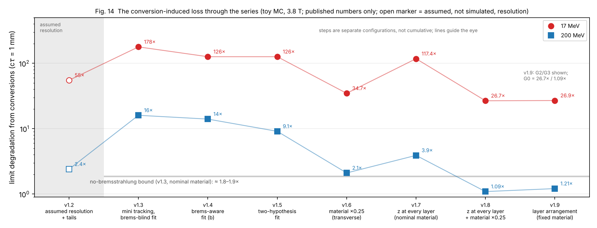

# ALP-ttbar Toy MC v2.0: Series Overview (v1.0–v1.9) — What a Preregistered Toy Study Learned about Displaced Light ALP → e⁺e⁻ and Photon Conversions, and Open Questions for Full-Simulation Studies

An overview of a small, numpy-only, mostly preregistered toy Monte Carlo series motivated by the displaced-dielectron
study of long-lived ALPs in top-quark events by Alimena et al. [1], which extends the displaced-dimuon strategy of
Rygaard et al. [2]. **No new simulation or fit**: every number is taken from the published records v1.0–v1.9.

> **Disclaimer.** Independent personal project by a non-specialist. Not affiliated with the authors of Refs. [1, 2] or
> with the CMS, LHCb or ALICE Collaborations or the FCC study. Kinematics are parametrised and detector numbers assumed;
> absolute numbers are not predictions for any real detector. Only trends and ratios inside the toy are meaningful.

## Contents of the PDF

1. The question and the two source papers (including the limitations they state themselves)
2. How the series worked (toy ingredients, preregistration, identity checks)
3. What happened, version by version (Figure 14, Table 1)
4. What was learned (seven lessons); 4a. the failed Wilks validation of v1.5 and what it changed
5. What a toy can and cannot say
6. Six open questions where full or fast simulation could help
7. Related work: next-generation low-material trackers (HL-LHC CMS Phase-2 and ATLAS ITk, ALICE ITS3, ALICE 3, FCC-ee, FCC-SEED); 7a. six toy-level suggestions for HL-LHC and FCC-ee tracker studies (for discussion, not design recommendations)
8. Future directions (material veto, dimuon control study, μ⁺μ⁻ above 200 MeV, ALPs from B-meson decays, other long-lived-particle signatures, a lepton-collider geometry)
9. Limitations, 10. Records, references (30)

## Main points (toy level)

- At 17 MeV and cτ = 1 mm the loss in reach from the photon-conversion veto is ≈ 2× without bremsstrahlung but 126–178×
  with it at nominal material.
- Better electron fits and a two-hypothesis vertex fit barely change it; **reducing the material is the only large
  handle** (127× → 35× for a quarter of the material); z at every layer adds to it (→ 27×); the **arrangement** of the
  pixel layers at fixed material does not matter.
- **Wilks' theorem failed once, and that changed the method.** In v1.5 the preregistered χ²₁ reference failed on a
  null sample (median 0.000 instead of ≈ 0.45): the free vertex absorbs the opening angle at first order, so the null
  lies on a boundary; Wilks is then replaced by the Chernoff / Self–Liang boundary result, here ½χ²₀ + ½χ²₁. From then on regularity was checked in
  advance; the boundary-aware references preregistered in v1.7 (χ²₁ for r–z, ½χ²₁ + ½χ²₂ for 3D) were confirmed.
- **Predictions:** 32 of 48 frozen predictions (v1.2–v1.9) confirmed, 16 refuted: v1.2 3/4, v1.3 1/5, v1.4 2/5,
  v1.5 3/6, v1.6 4/7, v1.7 6/7, v1.8 6/7, v1.9 7/7.

## Toy-level suggestions for tracker studies (§7a, for discussion)

- **S1.** Add a displaced, collimated e⁺e⁻ benchmark to layout studies (light ALPs decay mostly at 0.1–0.8 m).
- **S2.** Count material where displaced vertices occur, not only in front of the first layer.
- **S3.** Consider coarse z information in the outer tracker.
- **S4.** Treat the material veto (material map, 3D or likelihood tag) as part of the design.
- **S5.** For sub-mrad openings, material reduction may matter more than electron-fit sophistication.
- **S6.** Calibrate conversion-versus-decay discriminants before fixing thresholds.

These need confirmation with full simulation of a real geometry; the toy cannot weigh them against flavour tagging,
cost or other design drivers.

## Future directions (each under a public preregistration)

1. The material veto itself (v1.10).
2. Dimuon control study.
3. μ⁺μ⁻ above 200 MeV.
4. ALPs from B-meson decays (B → K⁽*⁾a).
5. Other long-lived-particle signatures with displaced lepton pairs (dark photons, heavy neutral leptons, Higgs-portal scalars).
6. A lepton-collider (FCC-ee-like) toy geometry.
7. Joint 3D fit, Gaussian-sum filter, calibrated test statistics.

## Files

| file | content |
|---|---|
| `ALP_ttbar_Displaced_Dielectron_Toy_MC_v2.0_Series_Overview_Lessons_Open_Questions_2026-11-09.pdf` | the overview (7 pages) |
| `fig14_series_overview.png`, `plot_fig14.py` | Figure 14, drawn only from published numbers |
| `linkedin_overviews/` | the one-page overviews posted with the compilations of v1.0–v1.2, v1.6–v1.7, v1.8 and v1.9, unchanged (page 1 only; the attached reports are on Zenodo under their own DOIs) |
| `LICENSE` | MIT |

## Records

| version | results (Zenodo DOI) | preregistration |
|---|---|---|
| v1.0 / v1.1 | 10.5281/zenodo.23825276 / 10.5281/zenodo.23833475 | – |
| v1.2 / v1.3 | 10.5281/zenodo.23847880 / 10.5281/zenodo.23862775 | GitHub (frozen README) |
| v1.4 | 10.5281/zenodo.23880375 | GitHub (frozen README) |
| v1.5 | 10.5281/zenodo.23924862 | 10.5281/zenodo.23905511 |
| v1.6 | 10.5281/zenodo.23952888 | 10.5281/zenodo.23942338 |
| v1.7 | 10.5281/zenodo.24011489 | 10.5281/zenodo.23995668 |
| v1.8 | 10.5281/zenodo.24034481 | 10.5281/zenodo.24028384 |
| v1.9 | 10.5281/zenodo.24052153 | 10.5281/zenodo.24048262 |

Code for all versions: https://github.com/wspaik5 (latest complete repository:
https://github.com/wspaik5/ALP_ttbar_Toy_MC_v1.9_Postregistration_Layer_Geometry).

## Citation

> Paik, W. S. (2026). *ALP-ttbar Toy MC v2.0: Series Overview (v1.0–v1.9) — What a Preregistered Toy Study Learned about
> Displaced Light ALP → e⁺e⁻ and Photon Conversions, and Open Questions for Full-Simulation Studies* [Preprint]. Zenodo.
> https://doi.org/10.5281/zenodo.24056097

## References

1. J. Alimena, F. Blekman, C. Cazzaniga, X. Cid Vidal, J. Niedziela, L. Rygaard, R. Soto Rey, *Hunting for Long-Lived ALPs in Top Events via Displaced Dielectron Pairs at the LHC*, [arXiv:2610.38932](https://arxiv.org/abs/2610.38932).
2. L. Rygaard, J. Niedziela, R. Schäfer, S. Bruggisser, J. Alimena, S. Westhoff, F. Blekman, *Top Secrets: long-lived ALPs in top production*, JHEP 10 (2023) 138, [arXiv:2306.08686](https://arxiv.org/abs/2306.08686).

The full reference list (30 entries) is in the PDF.

## License

MIT, see `LICENSE`.
